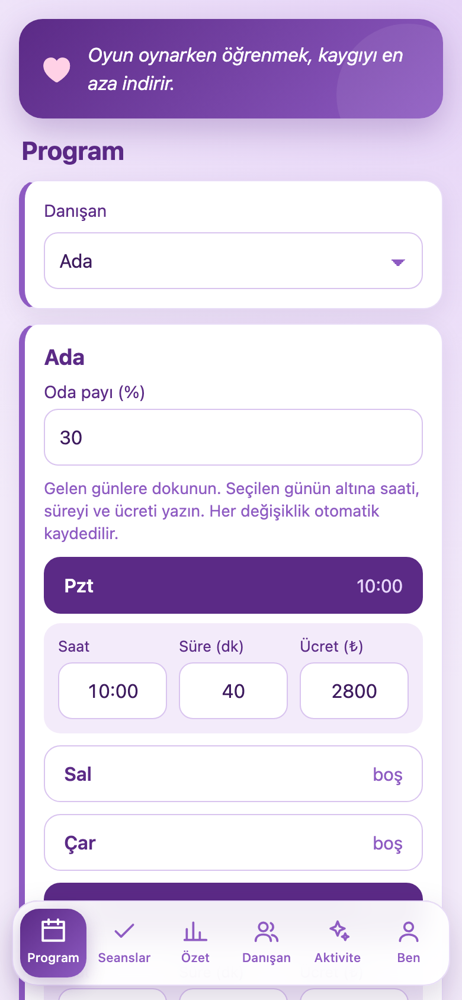
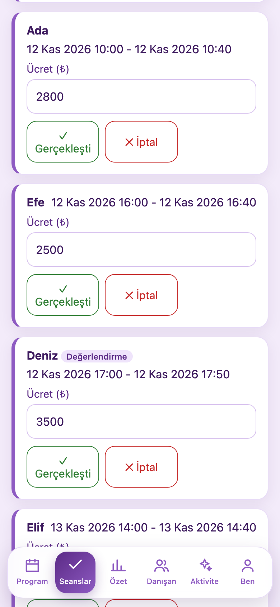
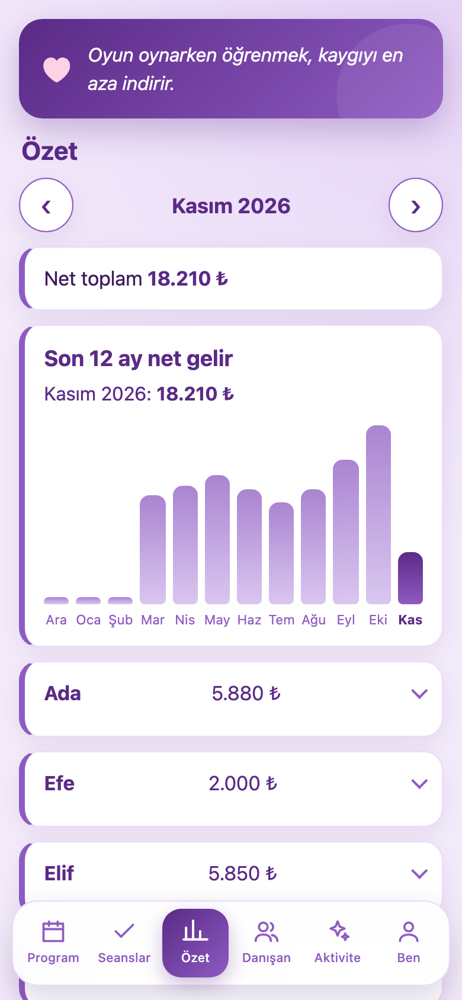
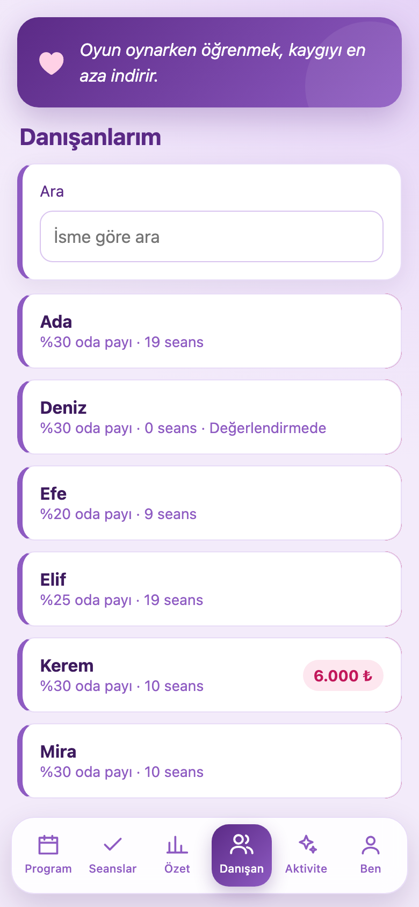
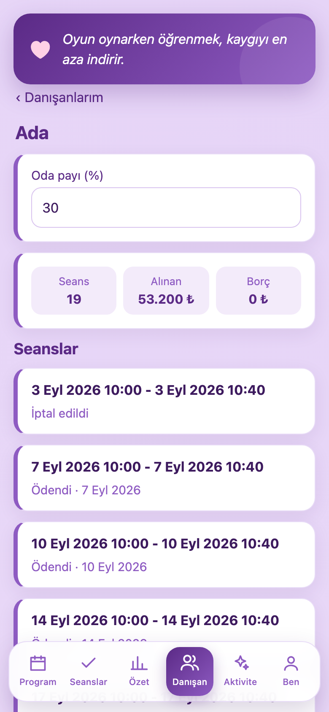
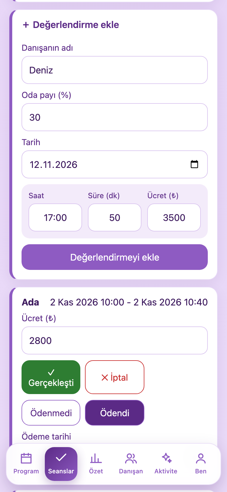
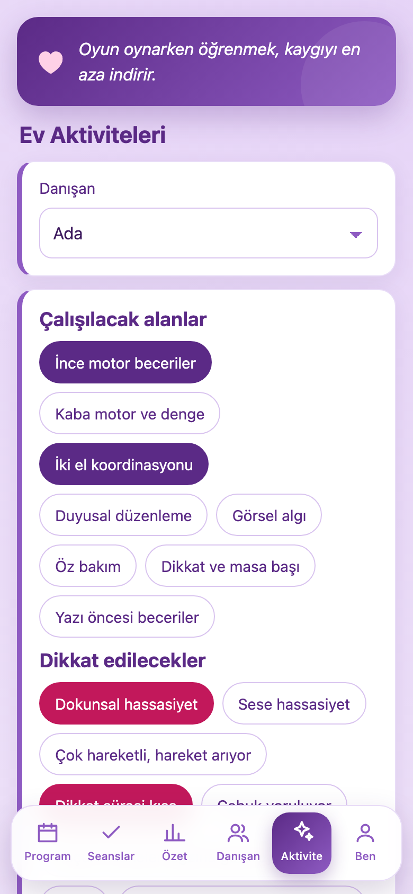
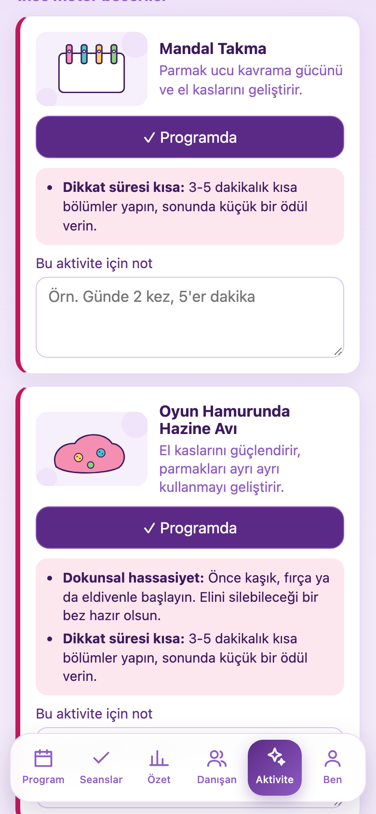
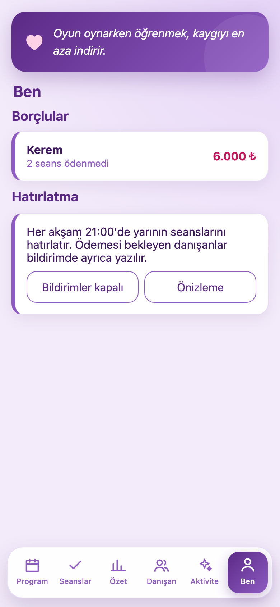

# Takip

Ergoterapi danışanlarının haftalık programını, seanslarını, ödemelerini ve aylık net kazancını telefonda takip etmek için küçük bir web uygulaması. Veriler yalnızca telefonda tutulur.

> Ekran görüntüleri uydurma örnek verilerle hazırlanmıştır; gerçek danışan bilgisi içermez.

## Ekranlar

<table>
  <tr>
    <td align="center"> <b>Program</b> Danışanın gelen günleri, saati, süresi ve ücreti</td>
    <td align="center"> <b>Seanslar</b> Bugünden açılan seans listesi, gerçekleşti / iptal</td>
    <td align="center"> <b>Özet</b> Aylık net toplam ve son 12 ayın grafiği</td>
  </tr>
  <tr>
    <td align="center"> <b>Danışanlar</b> Arama, borç rozeti, sola kaydırıp silme</td>
    <td align="center"> <b>Danışan detayı</b> Seans sayısı, alınan ve borç, tüm seanslar</td>
    <td align="center"> <b>Değerlendirme</b> Ücreti elle girilen tek seferlik değerlendirme</td>
  </tr>
  <tr>
    <td align="center"> <b>Ev aktiviteleri</b> Çocuğa göre çalışılacak alanlar ve dikkat edilecekler</td>
    <td align="center"> <b>Aktivite kartları</b> Resimli aktiviteler, çocuğa özel uyarlamalar ve notlar; PDF olarak indirilir</td>
    <td align="center"> <b>Ben</b> Borçlular ve akşam 21:00 hatırlatması</td>
  </tr>
</table>
